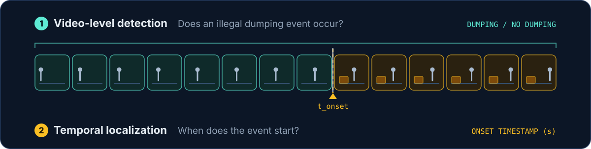
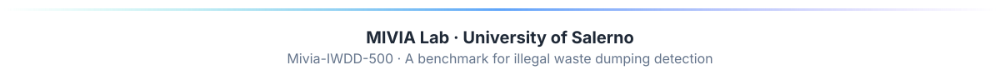

<div align="center">


[](https://doi.org/10.1016/j.imavis.2026.106125) [](https://drive.google.com/drive/folders/1DgXQnvK3keGP9BKB-cqpixnKaNLl2746?usp=sharing) [](https://drive.google.com/drive/folders/1OnA3rHn5uKAMEuHsQc11oxueTT-TQQwJ?usp=sharing) [](https://mivia.unisa.it/iwddcontest2027/) [](https://mivia.unisa.it/iwddcontest2026/)

<p align="justify"><b>Mivia-IWDD-500</b> is a fully balanced public video dataset developed for the automated detection and temporal localization of <b>illegal waste dumping events (IWDD)</b> in realistic surveillance footage. It comprises 500 videos, equally divided into 250 positive and 250 negative samples. The positive subset is further balanced between 125 static and 125 dynamic disposal events, enabling a controlled evaluation across two complementary behavioral modalities.</p>

</div>

<div align="center">
<a href="https://drive.google.com/drive/folders/1DgXQnvK3keGP9BKB-cqpixnKaNLl2746?usp=sharing"></a>&nbsp;&nbsp;<a href="https://drive.google.com/drive/folders/1OnA3rHn5uKAMEuHsQc11oxueTT-TQQwJ?usp=sharing"></a>
</div>

<br/>

Besides telling whether a dumping event occurs, the benchmark asks models to estimate **when** it starts. Negatives are deliberately **hard**: people carrying bags, workers picking up waste, garbage trucks and other look-alike activities.


• **Direct links:** [Training set (400 videos)](https://drive.google.com/drive/folders/1DgXQnvK3keGP9BKB-cqpixnKaNLl2746?usp=sharing) · [Public test set ID (100 videos)](https://drive.google.com/drive/folders/1OnA3rHn5uKAMEuHsQc11oxueTT-TQQwJ?usp=sharing)

<!-- TODO: add an "Alternative mirrors" line here (Hugging Face / Zenodo) if you publish the data there. -->

## Task

The benchmark has two coupled objectives: **video-level detection** (*does an illegal dumping event occur?*) and **temporal localization** (*at which timestamp does it start, in positive videos?*). Reliable systems must combine scene understanding with fine-grained temporal reasoning, since the same objects and motions also appear in legitimate activities.



| | Static dumping | Dynamic dumping |
|:---|:---|:---|
| **Definition** | Waste left at a fixed location | Waste released while in motion |
| **Typical events** | Placing boxes, garbage bags, furniture or construction debris on the ground | Throwing or dropping waste while walking or from a moving vehicle |
| **Example** |  |  |

<details>
<summary><b>How the data was collected</b></summary>

<br/>

Most positive videos come from real surveillance systems, both concealed and openly installed cameras, and show authentic, unscripted events. The footage covers waste collection points, public dumping areas, roadside zones and rural or vegetated locations, with variable camera angle, illumination, time of day, clutter and occlusion.

Negative samples were selected as **hard negatives**: subjects who seem to place or drop an object without abandoning it, people carrying bags or boxes, vehicles or pedestrians near pre-existing waste, people picking objects up from the ground, sanitation workers, garbage trucks and authorized cleaning operations. They reduce shortcut learning and false alarms.

</details>

## Annotations

All annotations were produced by human annotators. For positive videos the **onset** is the first frame at which the dumping action becomes visible. Annotations are weakly temporal: only the onset is provided, not dense frame-level labels.

| Component | Applies to | Values |
|:---|:---|:---|
| Video-level label | all videos | `DUMPING` / `NO DUMPING` |
| Event-onset timestamp | positive videos | seconds on the video timeline |
| Disposal modality | positive videos | `STATIC` / `DYNAMIC` |
| Time of day | all videos | `DAY` / `NIGHT` |
| Illumination | all videos | `BRIGHT` / `DIM` |

<details>
<summary><b>JSON format</b> (positive and negative examples)</summary>

<br/>

The two classes share the same structure and differ only in `label`, `timestamp` and `event_type`.

**Positive video**: `timestamp` is the onset in seconds, `event_type` is `static dumping` or `dynamic dumping`.

```json
{
  "label": "true",
  "timestamp": 2,
  "metadata": {
    "video_id": "vid0012.mp4",
    "resolution": "1920x1080",
    "frame_rate": 59.94,
    "duration": 15.63,
    "event_type": "dynamic dumping"
  }
}
```

**Negative video**: `label` is `"false"`, `timestamp` is `-1`, `event_type` is `normal`.

```json
{
  "label": "false",
  "timestamp": -1,
  "metadata": {
    "video_id": "vid0005.mp4",
    "resolution": "1920x1080",
    "frame_rate": 29.97,
    "duration": 17.42,
    "event_type": "normal"
  }
}
```

</details>

## Contest

Mivia-IWDD-500 is the official benchmark of the International Contest on Illegal Waste Dumping Detection (IWDD).

<a href="https://mivia.unisa.it/iwddcontest2027/"></a>

<a href="https://mivia.unisa.it/iwddcontest2026/"></a>

## Citation

If you use Mivia-IWDD-500 in scientific work, please cite:

```bibtex
@article{greco2026benchmarking,
  title     = {Benchmarking Illegal Waste Dumping Detection: A Public Video Dataset and a Reference Baseline},
  author    = {Greco, Antonio and Ricciardi, Andrea Vincenzo and Sansone, Carlo and Vento, Bruno},
  journal   = {Image and Vision Computing},
  volume    = {174},
  pages     = {106125},
  year      = {2026}
}

@inproceedings{bouwmans2026illegal,
  title     = {Illegal waste dumping detection},
  author    = {Bouwmans, Thierry and Greco, Antonio and Pierard, Sebastien and Ricciardi, Andrea Vincenzo and Sansone, Carlo and Van Droogenbroeck, Marc and Vento, Bruno},
  booktitle = {Proceedings of the IEEE/CVF Winter Conference on Applications of Computer Vision},
  pages     = {539--548},
  year      = {2026}
}
```

<!-- TODO: add a "License" section here once the terms of use are decided (e.g. a Creative Commons license), and add a LICENSE file to the repository. -->

## Authors

All authors contributed equally.

| Author | Affiliation | Contact |
|:---|:---|:---|
| **Antonio Greco** | DIEM, University of Salerno, Italy | [agreco@unisa.it](mailto:agreco@unisa.it) |
| **Andrea Vincenzo Ricciardi** | DIEM, University of Salerno, Italy | [anricciardi@unisa.it](mailto:anricciardi@unisa.it) |
| **Carlo Sansone** | DIETI, University of Naples Federico II, Italy | [carlo.sansone@unina.it](mailto:carlo.sansone@unina.it) |
| **Bruno Vento** | CINI, Italy | [brunovento.it@gmail.com](mailto:brunovento.it@gmail.com) |


